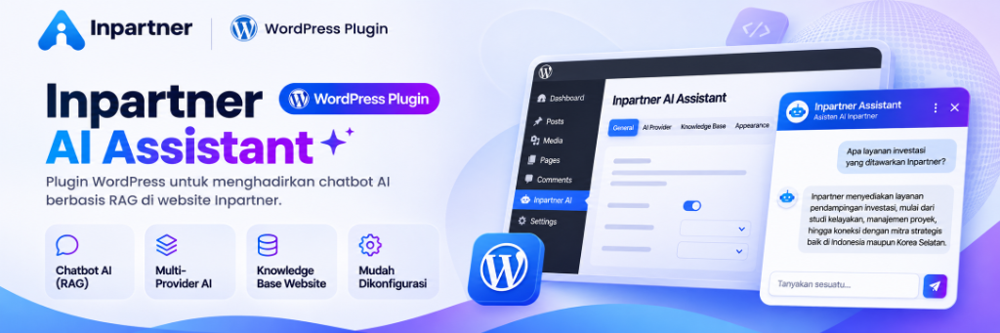

<p align="center">
  
</p>

# WP Knowledge Chat (Inpartner AI Assistant)

**Inpartner AI Business Consultation Assistant**: A production-hardened WordPress plugin and lightweight Node.js AI backend designed to provide grounded, source-attributed business consultation answers from the authoritative public content of [inpartnerglobal.com](https://inpartnerglobal.com) using Retrieval-Augmented Generation (RAG).

<p align="center">
  <a href="https://github.com/inpartnerhub/Plugin_WordPress/releases/tag/v1.2.1"></a>
  <a href="LICENSE"></a>
  
  
  
  
</p>

---

## 🌟 Core Pillars

| 💬 Chatbot AI (RAG) | ⚡ Multi-Provider AI | 📚 Knowledge Base Website | ⚙️ Mudah Dikonfigurasi |
|:---|:---|:---|:---|
| **Authoritative Answers**<br>Semua jawaban berbasis bukti resmi dari knowledge base Inpartner dengan sitasi tautan terverifikasi (`↗`). | **High-Availability Failover**<br>Dukungan multi-model Google Gemini dan OpenRouter (DeepSeek-Chat) dengan failover otomatis. | **Website Synchronization**<br>Sinkronisasi konten halaman layanan Inpartner secara aman, deterministik, dan terisolasi. | **Modern WordPress Admin**<br>Dashboard analitik leads, kartu metrik KPI, ekspor CSV, filter spam, dan kustomisasi visual. |

---

> [!IMPORTANT]
> **Release Status:** Current stable release is **[v1.2.1](https://github.com/inpartnerhub/Plugin_WordPress/releases/tag/v1.2.1)**.
> All automated tests pass: **152/152 backend unit tests**, **143/143 WordPress PHPUnit tests (764 assertions)**, **45/45 widget unit tests**, **12/12 HTTP and 16/16 real-browser E2E checks with 0 axe-core WCAG 2.1 AA violations**, and **0 PHPCS coding standard findings**.

---

## 📑 Table of Contents

- [Key Features](#-key-features)
  - [Visitor Experience](#1-visitor-experience--modern-chatbot-ui)
  - [Administrative Observability & Leads](#2-administrative-observability--lead-management)
  - [Security & Cost Control](#3-enterprise-security-ai-guardrails--cost-control)
- [Architecture & Flow](#-architecture--how-it-works)
- [Technology Stack](#-technology-stack)
- [Repository Layout](#-repository-layout)
- [Quick Start Guide](#-quick-start-local-development)
- [Automated Testing Suite](#-automated-testing-suite)
- [Configuration Reference](#-configuration-reference)
- [Deployment Instructions](#-deployment-instructions)
- [Documentation Index](#-documentation-index)
- [Contributing & Security](#-contributing--security)
- [License & Author](#-license--author)

---

## 🚀 Key Features

### 1. Visitor Experience & Modern Chatbot UI
- **Branded Corporate Design**: Styled in `inpartnerglobal.com` corporate blue palette (`#0076db`), featuring crisp 13.5px/14px typography hierarchy, 1.55 line height, subpixel font smoothing, and modern sparkle bot avatar (`✦`).
- **Globe Dropdown Language Switcher**: Compact header trigger button (`🌐 EN ▾`) with floating card menu, seamlessly switching interface strings across **English**, **Bahasa Indonesia**, **한국어 (Korean)**, **日本語 (Japanese)**, and **简体中文 (Simplified Chinese)** without screen-reader text leakage.
- **Aerodynamic Send Action**: Circular 36px blue send button with interactive paper plane icon, smooth hover lift, and dynamic glow states when typing.
- **Collapsible Suggestion Chips**: Recommendation drawer starts closed by default for maximum screen real estate; opens and closes with smooth animation via the `+` action button.
- **Asymmetric Bubble Geometry**: User bubbles rounded at `18px 18px 4px 18px` in soft ice blue (`#eaf4fd`) with subtle border, and assistant bubbles at `18px 18px 18px 4px` in pure white (`#ffffff`) with clean borders (`#e2e8f0`).
- **Structured Citation Cards**: Grounded answers display dedicated `.wkc-sources` cards with uppercase bold labels, verified URLs, and external navigation icons (`↗`).
- **Consultation Request Form**: Integrated consultation submission card allowing visitors to send contact details and advisory inquiries directly inside the chat window.
- **Centered Disclaimer & Expectations**: Centered footer disclaimer ("AI can make mistakes. Please verify important information.") and direct contact link to ensure clear user expectations.
- **Full-Width Mobile Sheet**: Responsive transformation on mobile devices (`100vw`, `85dvh`) with large touch targets (≥ 36px/44px) and zero horizontal overflow.
- **Certified Accessibility**: **0 violations in axe-core** for WCAG 2.1 AA accessibility compliance across all modal states.

### 2. Administrative Observability & Lead Management
- **Modern WordPress Dashboard**: Branded executive banner with real-time backend connection status pills.
- **Executive Metric Cards**: Track total conversations, grounded response rates, captured consultation leads, and intercepted threat counts.
- **Lead Capture & One-Click CSV Export**: View incoming consultation requests in WordPress, download them as CSV, and maintain compliance with WordPress core *Export Personal Data* and *Erase Personal Data* tools.
- **Anti-Spam Filtering**: Automatic rejection of disposable/throwaway email domains (3,000+ domain blocklist) and hidden honeypot bot trap fields.
- **Content Gap Tracker**: Observes unanswerable visitor queries to help marketing and consulting teams identify missing service content.
- **Knowledge Base Sync Manager**: View published service pages and trigger on-demand synchronization to the AI backend.

### 3. Enterprise Security, AI Guardrails & Cost Control
- **Dual-Provider Architecture**: Seamless failover between **Google Gemini API** (`gemini-1.5-flash` / `gemini-2.5-flash`) and **OpenRouter API** (`deepseek/deepseek-chat`).
- **Server-Side PII Scrubbing**: Automatic redaction of Indonesian NIK (16-digit ID), credit cards, emails, and phone numbers before logging or LLM transmission (`src/services/pii.ts`).
- **Deterministic Abstention Gate**: Questions lacking authoritative evidence in the Inpartner Knowledge Base are intercepted **before calling external LLMs**, eliminating token cost and hallucination risk.
- **Hardened Prompt Injection Defense**: Pre-model filter blocks injection, jailbreaks, and Indonesian slang/obfuscated abuse attempts.
- **Secret Isolation**: API keys and shared secrets are never exposed in client bundles, browser storage, or WordPress database options; requests are authenticated via server-to-server HMAC-SHA256 signatures with nonce replay protection.

---

## 🏗️ Architecture & How It Works

```
 ┌──────────────────────┐             ┌────────────────────────────────┐             ┌───────────────────────────────┐
 │   Visitor Browser    │             │   WordPress (Shared Hosting)   │             │   AI Backend (Node/Netlify)   │
 ├──────────────────────┤             ├────────────────────────────────┤             ├───────────────────────────────┤
 │                      │   POST      │ /wp-json/wp-knowledge-chat/v1/ │  HMAC-SHA256 │ POST /api/chat                │
 │ chat-widget.js       │────────────▶│ • Origin check                 │────────────▶│ • Verify signature & replay   │
 │ • DOM textContent    │  (REST)     │ • Rate limiting (per-IP)       │   (HTTPS)   │ • Rate limit & PII scrub      │
 │ • Scoped CSS         │             │ • Input sanitisation (≤500ch)  │             │ • Abstention & scope gate     │
 │ • No dependencies    │◀────────────│ • Re-verify sources & URLs     │◀────────────│ • BM25 retrieval over KB      │
 │                      │   JSON      └────────────────────────────────┘   JSON      │ • Response cache check        │
 └──────────────────────┘                                                            │ • Prompt with delimited chunks│
            │                                                                        │ • Claim check & sanitisation  │
            │                                                                        └──────────────┬────────────────┘
            │ POST /wp-json/wp-knowledge-chat/v1/lead                                               │
            ▼                                                                                       ▼
 ┌──────────────────────────────────────┐                                            ┌───────────────────────────────┐
 │   Lead Storage & Admin Management    │                                            │         AI Providers          │
 ├──────────────────────────────────────┤                                            ├───────────────────────────────┤
 │ • Private Post Type (wkc_lead)       │                                            │ 1. Google Gemini 1.5 Flash    │
 │ • Honeypot & Disposable Email Check  │                                            │ 2. OpenRouter DeepSeek-Chat   │
 │ • CSV Export & Core Privacy Tools    │                                            │    [Automatic Failover]       │
 └──────────────────────────────────────┘                                            └───────────────────────────────┘
```

1. **Visitor Question**: The visitor types a question in the floating widget or selects a suggestion chip.
2. **WordPress Proxy**: WordPress validates the input, enforces per-IP rate limits, and signs the request using an HMAC-SHA256 timestamped token.
3. **Guardrails & Retrieval**: The backend verifies the signature, strips PII, and runs lexical BM25 retrieval over authoritative Inpartner Knowledge Base chunks.
4. **Deterministic Gate**: If no relevant evidence exists, the backend returns an honest, localized fallback **without invoking the LLM**.
5. **Model Generation & Claim Check**: When evidence exists, the model generates an answer strictly constrained by delimited sources. The backend enforces that numbers, contacts, and URLs match the evidence before sending it back.

---

## 🛠️ Technology Stack

| Component | Technology | Version / Specification | Details |
|---|---|---|---|
| **CMS Platform** | WordPress | ≥ 6.4 (Tested on 7.1.3) | Clean integration via Settings, REST, and Options APIs |
| **Plugin Backend** | PHP | ≥ 8.1 (Tested on 8.5.5) | Fully typed, strict security standards, 0 PHPCS errors |
| **Chat Widget** | Vanilla JavaScript & CSS | ES5 compatible, WCAG 2.1 AA | Zero external frontend dependencies, scoped under `#wkc-root` |
| **AI Backend Service** | Node.js / TypeScript | Node ≥ 20.11 (TypeScript 5.9) | `node:http`, `node:crypto`, serverless Netlify adapter |
| **AI Models** | Gemini & OpenRouter | `gemini-1.5-flash` / `deepseek-chat` | Dual-provider support with automatic high-availability failover |
| **Retrieval Engine** | BM25 Search | Pure TypeScript implementation | NFKC normalization, Indonesian, Korean, Japanese & Chinese query expansion |
| **Testing Tools** | Node:test, PHPUnit, axe-core | PHPUnit 12.5, axe-core 4.14 | Headless Chrome E2E and real WordPress test suites |

---

## 📂 Repository Layout

```
.
├── plugin/wp-knowledge-chat/       # WordPress plugin source code
│   ├── wp-knowledge-chat.php       # Bootstrap file, version 0.5.0 constants
│   ├── includes/                   # PHP classes (Settings, Admin, REST, Analytics, Sync)
│   ├── assets/                     # Frontend assets (chat-widget.js, chat-widget.css, admin.css)
│   ├── languages/                  # Translation catalogs (.pot, .po, .mo, .l10n.php for ID & KO)
│   ├── readme.txt                  # WordPress plugin handbook compliant readme
│   └── tests/                      # PHPUnit, PHPCS, jsdom widget tests, and E2E browser checks
├── backend/                        # Node.js + TypeScript AI backend service
│   ├── src/                        # Express-free server, routing, services, and middleware
│   ├── data/                       # Authoritative Inpartner KB profile text and sources.json
│   ├── eval/                       # Grounding evaluation dataset and dynamic evaluation runner
│   └── tests/                      # Node.js native test suites (137 tests, 35 suites)
├── docs/                           # Architecture, security, admin guides, and visual screenshots
├── scripts/                        # Automation scripts (package-plugin.sh, test-all.sh)
├── CHANGELOG.md                    # Keep a Changelog compliant release history
├── prd.md                          # Product Requirements Document (v2.0)
└── README.md                       # Main project documentation
```

---

## ⚡ Quick Start (Local Development)

### Prerequisites
- **Node.js** ≥ 20.11
- **PHP** ≥ 8.1 with `pdo_sqlite` and `mbstring`
- **Composer** (for plugin test tooling)
- **Google Chrome** (for headless E2E browser tests)

### 1. Backend Setup
```bash
cd backend
npm install
cp ../.env.example .env

# Generate random 64-hex shared secret and index token:
npm run secret

# Build and start local service on port 8787:
npm run build && npm run start:local
curl http://127.0.0.1:8787/api/health
```

> [!TIP]
> **No API Key?** You can run the deterministic mock service:
> ```bash
> npm run mock:gemini    # Runs local mock model double on port 8790
> ```

### 2. WordPress Setup (Disposable Test Environment)
```bash
cd ../plugin/wp-knowledge-chat/tests
composer install && npm install
bash bin/setup-wp.sh    # Sets up a lightweight SQLite WordPress instance in .wp-test
```

---

## 🧪 Automated Testing Suite

All tests can be executed locally with a single command:

```bash
./scripts/test-all.sh
```

### Verified Test Results (Release v1.2.1)

| Test Suite | Command | Result | Details |
|---|---|:---:|---|
| **Backend Unit & Integration** | `npm --prefix backend test` | ✅ **152 / 152 Pass** | Dual provider, shared failover deadline, PII, auth, limits, ja/zh guardrails |
| **Widget DOM & Behavior** | `npm --prefix plugin/wp-knowledge-chat/tests run test:widget` | ✅ **45 / 45 Pass** | Widget lifecycle, safe rendering, five-language switcher, consultation trigger, lead job title and function |
| **WordPress Plugin PHPUnit** | `vendor/bin/phpunit` (in tests) | ✅ **143 / 143 Pass** | 764 assertions across Settings, REST, Admin, Leads |
| **PHP Coding Standards (PHPCS)**| `vendor/bin/phpcs` (in tests) | ✅ **100% Clean** | 0 errors, 0 warnings across all PHP files |
| **E2E Real Browser (Chrome)** | `./plugin/wp-knowledge-chat/tests/e2e/run.sh` | ✅ **16 / 16 Pass** | Computed styles, touch targets, grounded answer flow |
| **Axe-core Accessibility** | Integrated in `e2e/run.sh` | ✅ **0 Violations** | WCAG 2.1 AA certified across Desktop & Mobile views |
| **E2E HTTP API Checks** | Integrated in `e2e/run.sh` | ✅ **12 / 12 Pass** | Full WordPress REST ↔ Backend proxy flow |
| **Package Lifecycle** | `bash .../tests/bin/package-check.sh` | ✅ **Passed** | Clean install, activation, deactivation, uninstall |

---

## ⚙️ Configuration Reference

### WordPress (`wp-config.php`)
```php
define( 'WP_KNOWLEDGE_CHAT_BACKEND_URL', 'https://your-backend.example.com' );
define( 'WP_KNOWLEDGE_CHAT_SHARED_SECRET', 'your-random-64-hex-secret' );

// Optional: If running behind Cloudflare or trusted reverse proxy
define( 'WP_KNOWLEDGE_CHAT_TRUSTED_PROXIES', '10.0.0.0/8,172.16.0.0/12' );
```

### Backend (`.env`)
```bash
# Provider selection: 'openrouter' or 'gemini' (or leave unset for auto-failover if both keys exist)
LLM_PROVIDER=openrouter

# OpenRouter Configuration
OPENROUTER_API_KEY=sk-or-v1-...
OPENROUTER_MODEL=deepseek/deepseek-chat
OPENROUTER_FALLBACK_MODELS=google/gemini-2.0-flash-001

# Google Gemini Configuration
GEMINI_API_KEY=AIzaSy...
GEMINI_MODEL=gemini-1.5-flash

# Shared Secrets & Limits
CHAT_SHARED_SECRET=your-random-64-hex-secret
INDEX_API_TOKEN=your-separate-index-secret
DAILY_REQUEST_LIMIT=1000
RATE_LIMIT_PER_CLIENT_PER_MINUTE=8
```

---

## 🚢 Deployment Instructions

Summary steps (detailed step-by-step checklist in [docs/deployment.md](docs/deployment.md)):

1. **Deploy Backend**: Deploy `backend/` to an HTTPS Node.js runtime or serverless host (e.g. Netlify Functions) with environment variables set.
2. **Build Plugin Package**: Run `./scripts/package-plugin.sh` to generate the production ZIP (`dist/wp-knowledge-chat-0.5.0.zip`).
3. **Install on WordPress**: Upload the ZIP via **Plugins → Add New → Upload Plugin** and activate.
4. **Configure Constants**: Add `WP_KNOWLEDGE_CHAT_BACKEND_URL` and `WP_KNOWLEDGE_CHAT_SHARED_SECRET` to `wp-config.php`.
5. **Verify**: Click **Test Connection** in the admin dashboard and test a grounded question in the chat widget.

---

## 📚 Documentation Index

| Topic | Document | Target Audience |
|---|---|---|
| **Production Readiness Master Report** | [docs/audit/production-readiness-report.md](docs/audit/production-readiness-report.md) | Leadership, PMs & Lead Architects |
| **Complete Audit Suite (10 Reports)** | [docs/audit/](docs/audit/) | Security, QA, DevOps & Engineering Teams |
| **Administrator Guide** | [docs/admin-guide.md](docs/admin-guide.md) | Website Administrators & Content Teams |
| **Architecture Specification** | [docs/architecture.md](docs/architecture.md) | System Architects & Lead Developers |
| **API Contract & Schemas** | [docs/api-contract.md](docs/api-contract.md) | Backend Engineers & Integrators |
| **Security Design & Policy** | [docs/security.md](docs/security.md) | Security Engineers & DevOps |
| **Deployment Runbook** | [docs/deployment.md](docs/deployment.md) | DevOps & System Administrators |
| **Backend Technical Guide** | [backend/README.md](backend/README.md) | Node.js Backend Developers |
| **Knowledge Base & Ingestion**| [docs/knowledge-base.md](docs/knowledge-base.md) | Content & Knowledge Engineers |
| **Answer Quality Evaluation** | [docs/evaluation.md](docs/evaluation.md) | AI / RAG Quality Engineers |
| **WordPress Compliance** | [docs/wp-compliance.md](docs/wp-compliance.md) | WordPress Plugin Reviewers |
| **Product Requirements** | [prd.md](prd.md) | Product Managers & Stakeholders |

---

## 🤝 Contributing & Security

- **Contributing**: Please review [CONTRIBUTING.md](CONTRIBUTING.md) for branch naming, conventional commits, and coding standards.
- **Security Inquiries**: To report security issues or vulnerabilities, please follow the responsible disclosure guidelines in [SECURITY.md](SECURITY.md).

---

## 📄 License & Author

- **License**: Released under the terms of the **[GNU General Public License v2.0 or later (GPL-2.0-or-later)](LICENSE)**.
- **Author**: Built with care for **[Inpartner Global](https://inpartnerglobal.com)**.

