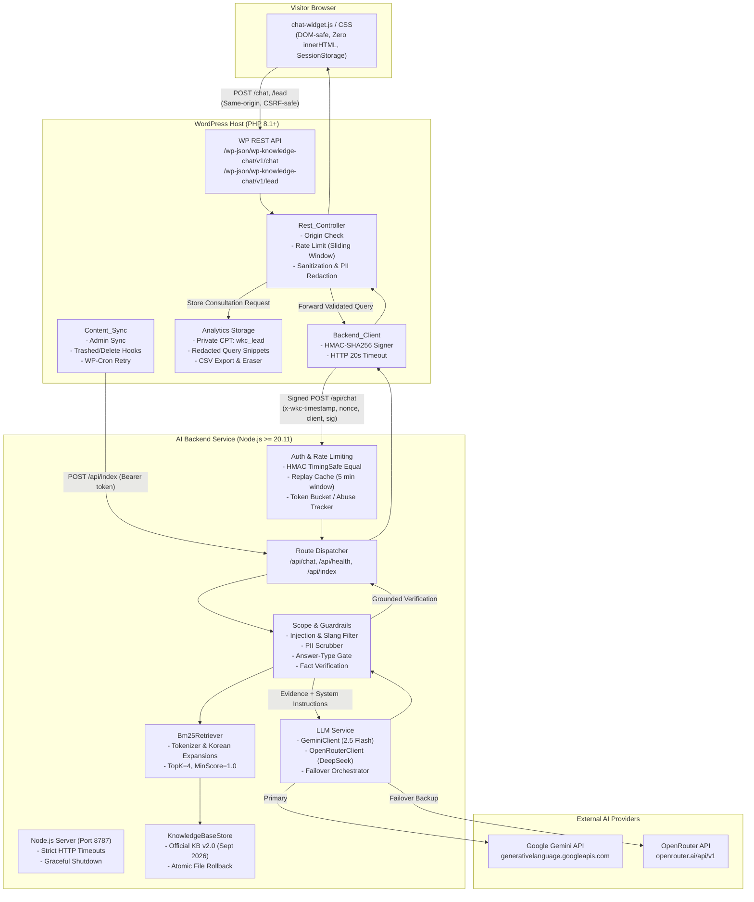

# Architecture Audit: Inpartner WordPress AI Chatbot

**Audit Date:** 2026-10-21  
**Auditor Role:** Senior WordPress Plugin Engineer, AI/RAG Engineer, Application Security Engineer, DevOps Engineer, QA Engineer  
**Repository:** [inpartnerhub/Plugin_WordPress](https://github.com/inpartnerhub/Plugin_WordPress)  
**Target Website:** [https://inpartnerglobal.com](https://inpartnerglobal.com)  
**Plugin Version:** 0.2.2  
**Backend Version:** 0.2.2  

---

## 1. System Overview & Architecture Diagram

The Inpartner WordPress AI Chatbot system consists of two primary operational components:
1. **WordPress Client Plugin (`wp-knowledge-chat`):** A custom, private WordPress plugin running on PHP 8.1+ (tested on PHP 8.5.5 and WordPress 7.1.3). It renders a lightweight vanilla JavaScript floating chat widget, provides a proxy REST API for frontend visitors, manages lead capture and metrics, and handles manual/automated synchronization of approved WordPress content to the AI backend.
2. **AI & Knowledge Retrieval Backend (`wp-knowledge-chat-backend`):** A standalone Node.js service (Node >= 20.11) with zero external production npm dependencies. It manages deterministic lexical BM25 retrieval over official company knowledge base files (`data/kb.json`), executes safety & scope guardrails, manages provider failover (Google Gemini 2.5 Flash and OpenRouter deepseek/deepseek-chat), and signs/verifies server-to-server requests via HMAC-SHA256.



---

## 2. Component Responsibilities

| Component | Files | Primary Responsibility |
|---|---|---|
| **Chat Widget** | `plugin/.../assets/js/chat-widget.js`<br/>`plugin/.../assets/css/chat-widget.css` | Renders floating chat UI; manages visitor sessions (`sessionStorage`); provides multi-language switching (EN, ID, KO); enforces accessible WCAG 2.1 A/AA controls; captures consultation lead inquiries. |
| **Plugin REST Controller** | `plugin/.../includes/class-rest-controller.php` | Exposes `/chat` and `/lead`; verifies request origin; enforces per-visitor sliding-window rate limit; hashes visitor IP with WordPress salt; routes authenticated payload to backend client. |
| **Backend Client** | `plugin/.../includes/class-backend-client.php` | Signs payloads with HMAC-SHA256 (`x-wkc-timestamp.nonce.clientId.body`); enforces HTTP timeouts (20s); manages signed connection health checks. |
| **Content Synchronization** | `plugin/.../includes/class-content-sync.php` | Manages synchronization of administrator-approved WordPress pages to `/api/index`; sanitizes page markup (Gutenberg, Elementor, shortcodes); manages WP-Cron retries for failed syncs. |
| **Analytics & Lead Manager** | `plugin/.../includes/class-analytics.php` | Stores captured consultation leads in a private custom post type (`wkc_lead`); redacts PII from recent query logs; handles CSV export, retention limits, and core WordPress privacy export/erase tools. |
| **Admin Interface** | `plugin/.../includes/class-admin-page.php` | Enforces `manage_options` capability and nonce verification on settings, manual sync, and lead administration screens; enqueues isolated admin styles and scripts without inline CSP violations. |
| **Backend App & Server** | `backend/src/server.ts`<br/>`backend/src/app.ts` | Validates environment variables at startup; configures HTTP server socket timeouts and keep-alive limits; orchestrates route handling; coordinates graceful termination on SIGTERM/SIGINT. |
| **Authentication & Protection** | `backend/src/lib/auth.ts`<br/>`backend/src/middleware/rate-limit.ts` | Performs constant-time HMAC comparison; prunes replay cache; applies per-client and global fixed-window rate limiting; enforces daily spend budget; tracks abuse penalties. |
| **Knowledge Base & Retrieval** | `backend/src/services/knowledge-base.ts`<br/>`backend/src/services/retrieval.ts` | In-memory document storage with atomic filesystem persistence; BM25 lexical ranking with multi-lingual query expansions (English, Indonesian, Korean particles). |
| **Guardrails & Scope** | `backend/src/services/scope.ts` | Pre-retrieval scope enforcement (injection, financial/tax/legal/medical advice, guarantees); deobfuscation of homoglyphs and leetspeak; pre-model answer-type gate; post-generation fact claim validation. |
| **LLM Orchestration** | `backend/src/services/llm.ts`<br/>`backend/src/services/chat.ts` | Executes structured schema prompting (`json_object`); handles timeout, backoff, and quota cooldowns; orchestrates automated failover between Google Gemini and OpenRouter. |

---

## 3. Request and Response Flow

### A. Visitor Chat Inquiry Flow
1. **Frontend Dispatch:** Visitor types a question in `chat-widget.js`. Widget validates character count (<= 500) and sends a `POST` request to `/wp-json/wp-knowledge-chat/v1/chat` with `credentials: 'omit'`.
2. **WordPress Ingestion & Rate Limit:**
   - Verifies `Origin` header matches `home_url()` or `site_url()`.
   - Strips non-printable unicode and control characters.
   - Evaluates client IP against a 60-second sliding-window transient counter (limit: 6 req/min/IP).
   - Generates an opaque, salted visitor token: `substr(hash_hmac('sha256', $ip, wp_salt('auth')), 0, 32)`.
3. **Backend Client Signing:** `Backend_Client` generates a random 16-byte nonce, records current unix timestamp, and computes HMAC-SHA256 signature using `WP_KNOWLEDGE_CHAT_SHARED_SECRET`.
4. **Backend Security Gate:**
   - Validates `x-wkc-timestamp` within `SIGNATURE_MAX_SKEW_SECONDS` (default: 300s).
   - Verifies HMAC using `crypto.timingSafeEqual()`. Rejects duplicate signatures within skew window.
   - Evaluates client limiter (8 req/min) and global limiter (60 req/min).
5. **RAG & Guardrail Pipeline:**
   - **Scope Check:** Scans question with `scopeViolation()`. If out-of-scope (prompt injection, investment advice, legal advice, etc.), returns pre-approved localized fallback immediately without calling the LLM.
   - **PII Scrubbing:** Redacts emails, phone numbers, Indonesian NIKs, and credit card numbers from user prompt.
   - **BM25 Retrieval:** Searches knowledge base chunks. If top chunk score < `RETRIEVAL_MIN_SCORE` (1.0), returns fallback.
   - **Answer-Type Check:** If question asks for prices, founding dates, client names, or office hours, validates that retrieved evidence actually contains matching factual patterns.
   - **Model Generation:** Dispatches prompt to primary LLM (Gemini 2.5 Flash). If transient error occurs, retries once or fails over to secondary LLM (OpenRouter deepseek-chat).
   - **Post-Generation Verification:** Verifies JSON output; rejects output containing internal instructions or secrets (`looksUnsafe()`); validates that all stated numbers, emails, URLs, and capitalized entity names exist in the retrieved sources (`unsupportedClaims()`).
6. **Delivery to Visitor:**
   - WordPress sanitizes response text via `sanitize_textarea_field()` and ensures source URLs match `Settings::approved_source_hosts()`.
   - Stores redacted query event in WordPress metrics.
   - Returns JSON to browser with `Cache-Control: no-store, private` and `X-Robots-Tag: noindex`.

---

## 4. Authentication & Trust Boundaries

```
[ Visitor Browser ] 
       │  (Untrusted Public Network)
       ▼
[ WordPress REST API ]  ──► Controls: Same-origin check, per-IP rate limit, input length limit.
       │  (Server-to-Server Network / VPC)
       ▼
[ AI Backend Service ]  ──► Controls: HMAC-SHA256 signature, 300s timestamp window, replay cache,
       │                               Bearer token (for /api/index), client & global rate limits.
       ▼
[ External AI APIs ]    ──► Controls: TLS 1.3, API Key headers, 12s timeout, 256KB body limit.
```

- **Browser to WordPress:** Publicly accessible. No user authentication required (designed for anonymous public visitors). Protected against CSRF and cross-site embedding via strict `Origin` header checking and per-IP rate limits.
- **WordPress to Backend:** Protected by HMAC-SHA256 mutual shared secret (`WP_KNOWLEDGE_CHAT_SHARED_SECRET`). Shared secrets are never transmitted in headers or bodies; only hashes of timestamp, nonce, client ID, and body are transmitted.
- **Knowledge Base Ingestion (`/api/index`):** Protected by a separate high-entropy Bearer token (`INDEX_API_TOKEN` / `WP_KNOWLEDGE_CHAT_INDEX_API_TOKEN`). Timing-safe comparison prevents side-channel leakage.
- **Backend to AI Providers:** Outbound HTTPS requests using API keys passed via authorization headers or query parameters (Gemini uses `x-goog-api-key` header where possible or validated query; OpenRouter uses `Authorization: Bearer`).

---

## 5. Configuration & Environment Variables

### WordPress Configuration (`wp-config.php`)
| Constant | Type | Description |
|---|---|---|
| `WP_KNOWLEDGE_CHAT_BACKEND_URL` | string (URL) | Backend service URL (must be HTTPS, or HTTP for localhost development). |
| `WP_KNOWLEDGE_CHAT_SHARED_SECRET` | string (>=32 chars) | Shared secret matching backend `CHAT_SHARED_SECRET`. |
| `WP_KNOWLEDGE_CHAT_INDEX_API_TOKEN` | string (>=32 chars) | Token matching backend `INDEX_API_TOKEN` for content synchronization. |
| `WP_KNOWLEDGE_CHAT_TRUSTED_PROXIES` | string (comma-separated) | Optional list of reverse proxy IP/CIDR blocks to accurately evaluate `X-Forwarded-For`. |

### Backend Service Configuration (`.env`)
| Variable | Default | Valid Range / Format | Description |
|---|---|---|---|
| `HOST` | `127.0.0.1` | Valid IP | Binding IP address for the HTTP server. |
| `PORT` | `8787` | 1 - 65535 | Listening TCP port. |
| `LLM_PROVIDER` | `gemini` | `gemini` \| `openrouter` | Primary LLM provider selection. |
| `GEMINI_API_KEY` | *(Required if Gemini)* | String | Google AI Studio / Gemini API key. |
| `GEMINI_MODEL` | `gemini-2.5-flash` | Valid model ID | Gemini model identifier. |
| `OPENROUTER_API_KEY`| *(Required if OpenRouter)*| String | OpenRouter API key. |
| `OPENROUTER_MODEL` | `deepseek/deepseek-chat`| `provider/model` | Primary OpenRouter model ID. |
| `OPENROUTER_FALLBACK_MODELS` | Empty | Up to 4 comma-separated | OpenRouter automatic fallback models. |
| `CHAT_SHARED_SECRET`| *(Required)* | >= 32 chars | Shared secret for signing `/api/chat` requests. |
| `INDEX_API_TOKEN` | *(Required)* | >= 32 chars | Bearer token for authorizing `/api/index` requests. |
| `ALLOWED_SOURCE_HOSTS`| `inpartnerglobal.com,...`| Comma-separated domains | Allowed domain names for source citations. |
| `KB_PATH` | `data/kb.json` | Valid file path | Path to knowledge base JSON snapshot. |
| `MAX_MESSAGE_CHARS`| `500` | 20 - 4000 | Maximum allowed characters in user message. |
| `RATE_LIMIT_PER_CLIENT_PER_MINUTE` | `8` | 1 - 1000 | Per-client rate limit window. |
| `RATE_LIMIT_GLOBAL_PER_MINUTE` | `60` | 1 - 100000 | Global server rate limit window. |
| `DAILY_REQUEST_LIMIT`| `1000` | 1 - 10000000 | Daily model-call spend cap (resets 00:00 UTC). |
| `LOG_LEVEL` | `info` | `debug` \| `info` \| `warn` \| `error` | Structured logging verbosity. |

---

## 6. Data Storage Locations

1. **WordPress Database:**
   - `wp_options`:
     - `wp_knowledge_chat_settings`: Widget status, greetings per language, default language, contact URL.
     - `wkc_metrics`: Aggregate conversation counts, language breakdown, security incident counts, and recent question snippets (redacted).
     - `wkc_synced_pages`: Map of WordPress page IDs approved and synced to the AI backend.
     - `wkc_sync_pending`: Failed synchronization jobs queued for WP-Cron retry.
   - `wp_posts` & `wp_postmeta`:
     - Custom post type `wkc_lead`: Stores captured consultative inquiries privately. Titles are static `'Lead'`; personal details are isolated in meta rows (`_wkc_name`, `_wkc_email`, `_wkc_company`, `_wkc_message`, `_wkc_language`, `_wkc_mail_status`).
   - `wp_options` (Transients):
     - `_transient_wkc_rl_*`: Short-lived visitor rate-limiting counters.
     - `_transient_wkc_lead_*`: Short-lived visitor lead submission counters.
     - `_transient_wkc_health_*`: Administrator connection test results.
2. **Backend Filesystem:**
   - `backend/data/kb.json`: Durable storage for compiled knowledge base documents and metadata.
   - `backend/data/profile/*.txt`: Authoritative company knowledge base source text.
   - `backend/data/sources.json`: Ingestion configuration, approved source IDs, and exclusion patterns.

---

## 7. Single Points of Failure & Architectural Discrepancies

### Single Points of Failure (SPOF)
1. **Single-Instance In-Memory Backend State:**
   - Rate limiters, the HMAC replay signature cache, the daily spend budget, and abuse penalty counters are stored in Node.js process memory.
   - *Impact:* Running multiple backend instances behind a round-robin load balancer without session affinity causes rate limits and replay caches to be split across instances. A restart resets in-memory counters.
   - *Mitigation:* The backend is purposefully architected as a single-instance container or systemd service.
2. **Serverless Limitations (Netlify Functions):**
   - On Netlify Functions, runtime index updates via `/api/index` are disabled (returns HTTP 501 `index_unsupported`) because filesystem writes are non-durable and memory is not shared across lambda instances.
   - *Recommendation:* Staging and Production deployments should use a dedicated VPS or container runtime (Node.js systemd / Docker) rather than serverless functions.
3. **AI Provider Availability:**
   - If Google Gemini experiences an outage or quota exhaustion, chat requests would fail if unmitigated.
   - *Mitigation:* The dual-provider failover implementation automatically routes requests to OpenRouter (`deepseek/deepseek-chat`) when both keys are configured.

### Documentation vs. Implementation Discrepancies Identified
1. **ResponseCache Dead Code:**
   - `ResponseCache` was introduced in commit `3a44397` but disconnected in commit `453487d` because sequential identical requests in daily budget unit tests bypassed model budget accounting. The class remains in `rate-limit.ts` but is not active in `app.ts`.
2. **Live Evaluation OpenRouter Support:**
   - `run-eval.ts` previously instantiated only `GeminiClient`, preventing live model evaluations on deployments configured exclusively with OpenRouter. This has been remediated in Phase 8.
3. **Widget Internationalization:**
   - `STRINGS.ko` in `chat-widget.js` lacked `leadFailed` and `leadPrivacy` keys, causing missing error notices and empty privacy paragraphs in Korean. This has been remediated in Phase 8.

