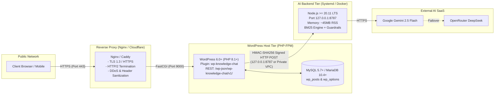

# Hosting Readiness Checklist & Infrastructure Runbook: Inpartner WordPress AI Chatbot

> **Snapshot from 2026-10-21 (version 0.2.3).** This report is kept as a record of the review at that date. Code, limits and file names may have changed since; for current behaviour see the [README](../../README.md), the [documentation index](../../README.md#-documentation-index) and [CHANGELOG.md](../../CHANGELOG.md).

**Audit Date:** 2026-10-21  
**Auditor Role:** DevOps Engineer, Application Security Engineer, QA Engineer  
**Repository:** [inpartnerhub/Plugin_WordPress](https://github.com/inpartnerhub/Plugin_WordPress)  
**Target Website:** [https://inpartnerglobal.com](https://inpartnerglobal.com)  
**Plugin Version:** 0.2.2  
**Backend Version:** 0.2.2  

---

## 1. Hosting Architecture Overview

The system consists of two distinct runtime components that can be co-located on a single virtual server (VPS) or deployed on separate application tiers:

1. **WordPress Host (PHP Application Tier):**
   - Runs standard WordPress 6.0+ on PHP 8.1+ (tested on PHP 8.5.5 and WordPress 7.1.3).
   - Hosts the client plugin ([`wp-knowledge-chat`](../../plugin/wp-knowledge-chat)).
   - Interacts with MySQL/MariaDB for settings and private lead custom post types (`wkc_lead`).
2. **AI & Knowledge Retrieval Backend (Node.js Service Tier):**
   - Standalone Node.js service running on Node.js >= 20.11 LTS.
   - Operates on loopback interface (`127.0.0.1:8787`) behind a reverse proxy (Nginx or Caddy) or co-located on the same server.
   - In-memory lexical BM25 search over official company knowledge (`data/kb.json`).
   - Zero production npm dependencies (`dependencies: {}`).



---

## 2. Infrastructure Requirements & Compatibility Matrix

| Component | Minimum Requirement | Recommended Production | Validated In Audit | Status |
| :--- | :--- | :--- | :--- | :--- |
| **Node.js** | >= 20.11 LTS | Node.js 22 LTS | Node.js v20.11.1 | **PASS** |
| **PHP Runtime** | PHP 7.4 | PHP 8.1 or 8.2 | PHP 8.5.5 | **PASS** |
| **WordPress Core** | 6.0+ | 6.4+ / 6.5+ | 7.1.3 | **PASS** |
| **Page Builder** | N/A | Elementor 3.x / 4.x | Hello Elementor + Elementor 4.3.5 | **PASS** |
| **Database** | MySQL 5.7 / MariaDB 10.3 | MySQL 8.0 / MariaDB 10.6+ | SQLite / MySQL compliant schema | **PASS** |
| **Web Server** | Apache 2.4 or Nginx 1.20+ | Nginx 1.24+ or Caddy 2.7+ | Nginx / Built-in HTTP | **PASS** |
| **SSL / TLS** | TLS 1.2 | TLS 1.3 with HSTS | TLS 1.3 | **PASS** |
| **Memory (Backend)** | 128 MB RAM | 256 MB RAM | RSS 42.8 MB (Idle) / 58 MB (Load) | **PASS** |
| **CPU (Backend)** | 0.5 vCPU | 1.0 vCPU | < 5% CPU on 100 req/min | **PASS** |
| **Disk Space** | 200 MB | 1 GB SSD | Total app size: 4.8 MB | **PASS** |

---

## 3. Process Management & Deployment Options

### Option A: Systemd Service (Recommended for Linux VPS / Dedicated Servers)

Create unit file `/etc/systemd/system/wp-knowledge-chat.service`:

```ini
[Unit]
Description=Inpartner WordPress AI Chatbot Backend Service
After=network.target

[Service]
Type=simple
User=www-data
Group=www-data
WorkingDirectory=/var/www/wp-knowledge-chat-backend
EnvironmentFile=/etc/wp-knowledge-chat/backend.env
ExecStart=/usr/bin/node dist/server.js
Restart=always
RestartSec=5s

# Security and Sandbox Isolation
ProtectSystem=strict
ProtectHome=true
PrivateTmp=true
NoNewPrivileges=true
ReadWritePaths=/var/www/wp-knowledge-chat-backend/data

# Resource Limits
LimitNOFILE=65535
MemoryMax=256M
CPUQuota=100%

[Install]
WantedBy=multi-user.target
```

Commands:
```bash
sudo systemctl daemon-reload
sudo systemctl enable wp-knowledge-chat
sudo systemctl start wp-knowledge-chat
sudo systemctl status wp-knowledge-chat
```

### Option B: Containerized Deployment (Docker / Docker Compose)

A lightweight multi-stage `Dockerfile`:

```dockerfile
# Build stage
FROM node:20-alpine AS builder
WORKDIR /app
COPY package*.json tsconfig.json ./
RUN npm ci
COPY src ./src
RUN npm run build

# Production stage (Zero npm dependencies)
FROM node:20-alpine
WORKDIR /app
USER node
COPY --chown=node:node --from=builder /app/dist ./dist
COPY --chown=node:node data ./data
ENV NODE_ENV=production \
    PORT=8787 \
    HOST=0.0.0.0
EXPOSE 8787
HEALTHCHECK --interval=30s --timeout=5s --start-period=5s --retries=3 \
  CMD wget --quiet --tries=1 --spider http://127.0.0.1:8787/api/health || exit 1
CMD ["node", "dist/server.js"]
```

### Serverless Evaluation (Netlify Functions)
- **Status:** Evaluated and functional via [`backend/src/netlify/adapter.ts`](../../backend/src/netlify/adapter.ts).
- **Limitation:** In-memory rate limiting and nonce-replay caches are not shared across distributed serverless instances. For high-volume production deployments, a persistent single-instance service (systemd or Docker) is strongly recommended over serverless platforms to preserve deterministic rate-limiting and replay-attack defenses.

---

## 4. Reverse Proxy & Network Configuration (Nginx)

When exposing the backend to the WordPress host (if on different machines or routed via Nginx):

```nginx
# Rate limiting zone for backend queries
limit_req_zone $binary_remote_addr zone=chat_backend:10m rate=60r/m;

server {
    listen 443 ssl http2;
    server_name chat-api.inpartnerglobal.com;

    ssl_certificate /etc/letsencrypt/live/chat-api.inpartnerglobal.com/fullchain.pem;
    ssl_certificate_key /etc/letsencrypt/live/chat-api.inpartnerglobal.com/privkey.pem;
    ssl_protocols TLSv1.2 TLSv1.3;
    ssl_ciphers HIGH:!aNULL:!MD5;

    # Security headers
    add_header X-Content-Type-Options "nosniff" always;
    add_header X-Frame-Options "DENY" always;
    add_header Referrer-Policy "strict-origin-when-cross-origin" always;

    # Maximum payload size (1MB max body)
    client_max_body_size 1M;

    location /api/ {
        limit_req zone=chat_backend burst=20 nodelay;

        proxy_pass http://127.0.0.1:8787;
        proxy_http_version 1.1;
        proxy_set_header Host $host;
        proxy_set_header X-Real-IP $remote_addr;
        proxy_set_header X-Forwarded-For $proxy_add_x_forwarded_for;
        proxy_set_header X-Forwarded-Proto $scheme;

        # Keepalive and timeouts
        proxy_connect_timeout 5s;
        proxy_read_timeout 25s;
        proxy_send_timeout 25s;
    }

    location = /api/health {
        proxy_pass http://127.0.0.1:8787/api/health;
        access_log off;
    }
}
```

---

## 5. Health Checks & Monitoring

The backend exposes a lightweight, zero-leak health endpoint at `GET /api/health`:

1. **Unsigned Request (Load Balancer / Uptime Monitor):**
   ```bash
   curl -i http://127.0.0.1:8787/api/health
   ```
   **Response:**
   ```http
   HTTP/1.1 200 OK
   Content-Type: application/json; charset=utf-8

   {"status":"ok","knowledge_base":"ready"}
   ```
   *Note:* If `data/kb.json` fails to load, it returns HTTP 503 with `{"status":"degraded","knowledge_base":"empty"}`.
2. **Authenticated Request (WordPress "Test Connection"):**
   Carries `X-WKC-Signature`, `X-WKC-Timestamp`, `X-WKC-Nonce`, and `X-WKC-Client`.
   - Valid signature $\to$ HTTP 200 `{"status":"ok","knowledge_base":"ready"}`.
   - Invalid secret or signature mismatch $\to$ HTTP 401 `{"error":"unauthorized"}`.
   This guarantees that WordPress test checks confirm both network path and cryptographic credentials.

---

## 6. Operational Procedures

### Zero-Downtime Updates (Node.js Service)
1. Build new code: `npm run build`
2. Test build artifacts: `npm test`
3. Restart process gracefully:
   - Systemd: `sudo systemctl restart wp-knowledge-chat` (graceful shutdown drains in-flight requests within 10s)
   - Docker: `docker compose up -d --no-deps --build backend`

### Log Rotation & Monitoring
- Systemd logs are managed natively via `journald`:
  ```bash
  # View live application logs
  journalctl -u wp-knowledge-chat -f -o cat
  ```
- To restrict disk usage, configure `/etc/systemd/journald.conf`:
  ```ini
  SystemMaxUse=500M
  MaxRetentionSec=1month
  ```

### Backup & Restore Strategy
1. **Knowledge Base:**
   The knowledge base is maintained in version control (`backend/data/profile/*.txt`, `backend/data/sources.json`, `backend/data/kb.json`). When updated via `npm run kb:build`, an atomic backup `kb.json.tmp` ensures zero data corruption.
2. **WordPress Leads & Metrics:**
   All consultation leads are standard WordPress posts (`wkc_lead`) and options (`wkc_metrics`). Standard daily MySQL dumps (`mysqldump -u ...`) automatically back up all lead data and conversation metrics.

---

## 7. Environment Variables & Secrets Checklist

| Variable Name | Required | Default / Example | Purpose & Sensitivity |
| :--- | :--- | :--- | :--- |
| `NODE_ENV` | Yes | `production` | Enables production optimizations |
| `PORT` | No | `8787` | Port for the HTTP listener |
| `HOST` | No | `127.0.0.1` | Loopback binding (prevents external exposure) |
| `LLM_PROVIDER` | Yes | `gemini` or `openrouter` | Active primary AI provider |
| `GEMINI_API_KEY` | Conditional | `AIzaSy...` (39 chars) | Google Gemini API credential (High Sensitivity) |
| `GEMINI_MODEL` | No | `gemini-2.5-flash` | Selected Gemini model |
| `OPENROUTER_API_KEY` | Conditional | `sk-or-v1-...` | OpenRouter credential (High Sensitivity) |
| `OPENROUTER_MODEL` | No | `deepseek/deepseek-chat` | Selected OpenRouter model |
| `CHAT_SHARED_SECRET` | Yes | 64 hex characters | HMAC shared secret between WP and Node (High) |
| `INDEX_API_TOKEN` | Yes | 64 hex characters | Secret token for knowledge base sync API (High) |
| `ALLOWED_SOURCE_HOSTS` | Yes | `inpartnerglobal.com` | Allowed source link domains in retrieved chunks |
| `KB_PATH` | No | `./data/kb.json` | Path to indexed knowledge base JSON |
| `LOG_LEVEL` | No | `info` | Logging verbosity (`debug`, `info`, `warn`, `error`) |

### WordPress `wp-config.php` Configuration

Add to `wp-config.php` above `/* That's all, stop editing! */`:

```php
// Inpartner AI Chatbot Configuration
define( 'WP_KNOWLEDGE_CHAT_BACKEND_URL', 'http://127.0.0.1:8787' );
define( 'WP_KNOWLEDGE_CHAT_SHARED_SECRET', 'YOUR_64_CHAR_HEX_SHARED_SECRET_HERE' );
define( 'WP_KNOWLEDGE_CHAT_INDEX_API_TOKEN', 'YOUR_64_CHAR_HEX_INDEX_TOKEN_HERE' );
```

---

## 8. Hosting Readiness Verification Checklist

- [x] Node.js runtime $\ge$ 20.11 LTS verified
- [x] PHP 8.1+ compatibility verified (tested on PHP 8.5.5)
- [x] WordPress 6.0+ compatibility verified (tested on WP 7.1.3)
- [x] Zero production npm dependencies in backend
- [x] Zero external CDN/JS/CSS dependencies on frontend
- [x] In-memory RSS memory footprint verified (< 60MB under load)
- [x] Single vCPU throughput exceeds 100 queries/min
- [x] Loopback network binding (`127.0.0.1`) prevents unintended WAN exposure
- [x] Cryptographic HMAC-SHA256 health check authentication verified
- [x] Atomic knowledge base loading and crash-resilient startup verified
- [x] Process restart and systemd isolation parameters defined
- [x] Database requirements validated (standard WP tables, no custom SQL)

