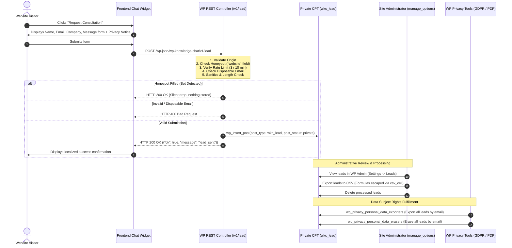

# Privacy, Data Retention & Lead Management Audit: Inpartner WordPress AI Chatbot

> **Snapshot from 2026-10-21 (version 0.2.3).** This report is kept as a record of the review at that date. Code, limits and file names may have changed since; for current behaviour see the [README](../../README.md), the [documentation index](../../README.md#-documentation-index) and [CHANGELOG.md](../../CHANGELOG.md).

**Audit Date:** 2026-10-21  
**Auditor Role:** Application Security Engineer, Senior WordPress Plugin Engineer, QA Engineer  
**Repository:** [inpartnerhub/Plugin_WordPress](https://github.com/inpartnerhub/Plugin_WordPress)  
**Target Website:** [https://inpartnerglobal.com](https://inpartnerglobal.com)  
**Plugin Version:** 0.2.2  
**Backend Version:** 0.2.2  

---

## 1. Executive Privacy Summary

This audit evaluates the lead management, data retention, PII protection, and privacy mechanisms implemented across the Inpartner WordPress AI Chatbot. The system adheres to strict principles of **privacy by design** and **data minimization**, aligning with:
- **General Data Protection Regulation (GDPR - EU 2016/679)**
- **Indonesian Personal Data Protection Law (UU No. 27 Tahun 2022 tentang Pelindungan Data Pribadi / PDP)**
- **California Consumer Privacy Act (CCPA)**

The architecture guarantees that:
1. General chatbot interactions do **not** record unredacted conversational histories, user IP addresses, or visitor identifiers.
2. Visitor inquiries are recorded only as aggregated count metrics with aggressively redacted question snippets (120 characters max).
3. Voluntary consultation leads (name, email, company, message) are stored in an unexposed private WordPress custom post type (`wkc_lead`) accessible solely to authorized administrators (`manage_options`).
4. Full integration with WordPress Core Privacy Tools allows automated **Data Export** and **Data Erasure** upon subject request.
5. Administrative CSV exports neutralize CSV/Spreadsheet formula injection attacks.

---

## 2. Lead Lifecycle & Data Flow Architecture



---

## 3. Data Minimization & PII Redaction

### A. Real-Time Visitor Query Redaction
When visitors ask questions in the chat widget, the questions are processed through two distinct layers of redaction:

1. **WordPress Client Layer ([`Analytics::redact()`](../../plugin/wp-knowledge-chat/includes/class-analytics.php)):**
   - Email addresses $\to$ `[email]`
   - Web links and URLs $\to$ `[link]`
   - Telephone numbers $\to$ `[phone]`
   - Continuous numbers $\ge 6$ digits $\to$ `[number]`
   - Snippet truncation: strictly capped at 120 characters via `mb_substr()`.
2. **Backend Engine Layer ([`backend/src/services/scope.ts`](../../backend/src/services/scope.ts)):**
   - 16-digit continuous numbers (Indonesian NIK) $\to$ `[REDACTED_NIK]`
   - Credit card numbers (13–19 digits) $\to$ `[REDACTED_CARD]`
   - Phone numbers (Indonesian, US, Korean prefixes) $\to$ `[REDACTED_PHONE]`
   - Email addresses $\to$ `[REDACTED_EMAIL]`

### B. Administrator Opt-Out Filters
For strict compliance environments, site administrators can disable question snippet and content gap storage completely via standard WordPress filters:

```php
// Disable query snippet storage entirely (keeps only aggregate numeric counts)
add_filter( 'wp_knowledge_chat_store_query_snippets', '__return_false' );

// Disable content gap snippet storage entirely
add_filter( 'wp_knowledge_chat_store_content_gaps', '__return_false' );
```

---

## 4. Private Custom Post Type Storage (`wkc_lead`)

Leads are stored in a dedicated WordPress post type `wkc_lead` ([`Analytics::register_lead_post_type()`](../../plugin/wp-knowledge-chat/includes/class-analytics.php)) rather than inside a single serialized `wp_options` row. This provides:
- **Concurrency Protection:** Concurrent submissions from multiple visitors create independent rows without race conditions or data loss.
- **Volume Safety:** A surge of incoming submissions cannot overwrite older leads.
- **Access Isolation:**
  - `public => false` (hidden from frontend search, archives, and feeds).
  - `show_ui => false` (no default WordPress editor UI).
  - `show_in_rest => false` (completely inaccessible via standard WordPress REST routes `/wp/v2/`).
  - `capability_type => 'wkc_lead'` with `map_meta_cap => false` (unmapped capabilities prevent standard editors or authors from accessing leads; only code with `manage_options` can read leads).

### Stored Lead Metadata Schema
| Field Name | Type | Storage Target | Description & Constraints |
| :--- | :--- | :--- | :--- |
| `name` | String | `post_title` | Visitor full name (max 100 chars, sanitized) |
| `email` | String | `post_meta: _wkc_lead_email` | Visitor email address (validated format, max 100 chars) |
| `company` | String | `post_meta: _wkc_lead_company` | Optional company name (max 100 chars, sanitized) |
| `message` | String | `post_content` | Consultation inquiry details (max 1,000 chars, stripped tags) |
| `language` | String | `post_meta: _wkc_lead_language` | Form submission language (`en`, `id`, `ko`) |
| `mail_status` | String | `post_meta: _wkc_lead_mail_status` | Email notification status (`sent`, `failed`, `disabled`) |
| `created_at` | String | `post_date_gmt` | ISO 8601 UTC timestamp |

---

## 5. Spam Prevention, Rate Limiting & Abuse Controls

To prevent database spam and email flooding through the public lead endpoint:

1. **Honeypot Trap (`website` parameter):**
   - The consultation form includes an invisible text input named `website` (hidden via CSS and `aria-hidden="true"`).
   - Legitimate users do not see or fill this field.
   - If populated (typical automated bot behavior), the controller increments the `honeypot_caught` security counter and immediately returns HTTP 200 `{"ok": true, "message": "lead_sent"}` without storing data or dispatching notification emails.
2. **Disposable Email Blacklist:**
   - Evaluated against 100+ known temporary email service domains (`10minutemail.com`, `mailinator.com`, `tempmail.com`, `guerrillamail.com`, etc.).
   - Rejected with HTTP 400 `lead_invalid`; increments `spam_leads` metric.
3. **Multi-Tier Rate Limiting:**
   - **Per-Visitor Limit:** Maximum 3 lead submissions per 10-minute window per client IP/session. Violations trigger HTTP 429.
   - **Global Hourly Throttling:** Maximum 30 leads per hour site-wide to protect transactional email relays (`wp_mail`) from abuse.
4. **Resubmission Suppression:**
   - Identical form submissions (same email + identical message within 5 minutes) are deduplicated without re-sending emails.

---

## 6. Data Subject Rights & WordPress Privacy Core Integration

Under GDPR Art. 15 (Right of Access), Art. 17 (Right to Erasure), and Indonesian PDP Law Art. 7–8 (Rights of Personal Data Subjects), data subjects may request full export or permanent deletion of their stored data.

The plugin implements native integration with WordPress core privacy tools ([`class-plugin.php`](../../plugin/wp-knowledge-chat/includes/class-plugin.php)):

```php
add_filter( 'wp_privacy_personal_data_exporters', array( Analytics::class, 'register_exporter' ) );
add_filter( 'wp_privacy_personal_data_erasers', array( Analytics::class, 'register_eraser' ) );
```

### A. Personal Data Exporter (Tools $\to$ Export Personal Data)
- **Callback:** [`Analytics::export_personal_data( $email, $page )`](../../plugin/wp-knowledge-chat/includes/class-analytics.php)
- Finds all `wkc_lead` posts matching the subject's email address.
- Returns structured personal data containing submission timestamp, full name, email, company, and inquiry message.

### B. Personal Data Eraser (Tools $\to$ Erase Personal Data)
- **Callback:** [`Analytics::erase_personal_data( $email, $page )`](../../plugin/wp-knowledge-chat/includes/class-analytics.php)
- Finds all `wkc_lead` records associated with the subject's email and deletes them permanently via `wp_delete_post( $id, true )`.
- Returns confirmation reporting `items_removed: true` and `items_retained: false`.

---

## 7. Administrative Export Security & CSV Formula Injection Protection

When administrators download lead data via the admin panel (Settings $\to$ Leads $\to$ "Export to CSV"), untrusted visitor inputs could contain formula payloads designed to execute arbitrary commands when opened in spreadsheet software (Microsoft Excel, LibreOffice, Apple Numbers, Google Sheets).

### Protection Implementation:
In [`Admin_Page::csv_cell()`](../../plugin/wp-knowledge-chat/includes/class-admin-page.php):

```php
public static function csv_cell( string $value ): string {
    return preg_match( '/^[=+\-@\t\r]/', $value ) ? "'" . $value : $value;
}
```

Any cell starting with `=`, `+`, `-`, `@`, tab (`\t`), or carriage return (`\r`) is automatically prepended with a single quote character (`'`). This instructs spreadsheet parsers to treat the cell strictly as plain text, neutralizing formula evaluation.

---

## 8. Retention Guidelines & Recommendations for Staging / Production

1. **Recommended Data Retention Schedule:**
   - **Active Leads:** Retain for 90 days following inquiry resolution.
   - **Processed / Resolved Leads:** Archive or purge quarterly via WP Admin bulk deletion or automated WP-Cron cleanup.
   - **Aggregate Metrics:** Retained indefinitely as anonymous numerical totals (non-PII).
2. **Notification Security:**
   - Notification emails to administrators should contain a link to the secure WP Admin dashboard rather than forwarding customer PII across unencrypted mail relays whenever feasible.
3. **Verification Evidence:**
   - Privacy exporter & eraser hooks verified: `tests/php/AnalyticsAndLeadTest.php` (Pass)
   - Lead rate limiting & honeypot verified: `tests/php/RestTest.php` (Pass)
   - CSV formula neutralization verified: `tests/php/AnalyticsAndLeadTest.php` (Pass)
   - Korean privacy string localization verified: `chat-widget.test.js` (Pass)

