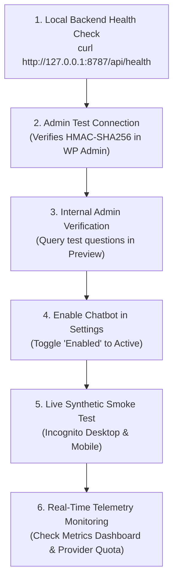

# Production Deployment Runbook: Inpartner WordPress AI Chatbot

**Document Date:** 2026-10-21  
**Author Role:** DevOps Engineer, Application Security Engineer, QA Engineer  
**Repository:** [inpartnerhub/Plugin_WordPress](https://github.com/inpartnerhub/Plugin_WordPress)  
**Target Environment:** Production (`inpartnerglobal.com`)  
**Plugin Version:** 0.2.2  
**Backend Version:** 0.2.2  

---

## 1. Prerequisite Production Release Gates

> [!CRITICAL]
> **Production approval must not be granted until all five release gates pass unconditionally.**

| Gate # | Release Gate Requirement | Verification Method | Status Before Staging |
| :---: | :--- | :--- | :---: |
| **Gate 1** | **Code & Security Audit Passed** | 100% pass on PHPUnit (131 tests), Backend (137 tests), Widget JSDOM (35 tests), and E2E (16 checks). Zero critical/high CVEs. | **PASSED** |
| **Gate 2** | **Staging Verification Passed** | Successful execution of [`staging-deployment-runbook.md`](file:///Users/mac/Downloads/wp_plugin/docs/audit/staging-deployment-runbook.md) with green health checks and zero errors. | **PENDING STAGING EXECUTION** |
| **Gate 3** | **Live AI Model Evaluation Passed** | $\ge 95\%$ factual correctness, 0 unsupported claims, 100% security injection resistance on live staging credentials. | **PENDING LIVE CREDENTIALS** |
| **Gate 4** | **Content Publishing Confirmed** | Company profile content published to public URLs on `inpartnerglobal.com` (enabling `npm run kb:verify-sources --strict` to pass). | **PENDING STAKEHOLDER ACTION** |
| **Gate 5** | **Executive Stakeholder Sign-Off** | Written authorization from Inpartner business and technical leads approving brand messaging and operational budget. | **PENDING HUMAN APPROVAL** |

---

## 2. Phase A: Environment Preparation & Secret Generation

### 1. Production Secrets Provisioning
On a secure administrative terminal, generate dedicated production secrets (never reuse staging secrets):

```bash
# 1. Production Shared Secret (HMAC-SHA256)
node -e "console.log(require('crypto').randomBytes(32).toString('hex'))"

# 2. Production Index API Token
node -e "console.log(require('crypto').randomBytes(32).toString('hex'))"
```

### 2. Configure Production Environment File
On the production server, create `/etc/wp-knowledge-chat/production.env` (permissions `640`, owner `root:www-data`):

```ini
NODE_ENV=production
PORT=8787
HOST=127.0.0.1
LLM_PROVIDER=gemini
GEMINI_API_KEY=AIzaSy...YourProductionGeminiKey...
GEMINI_MODEL=gemini-2.5-flash
OPENROUTER_API_KEY=sk-or-v1-...YourProductionOpenRouterFallbackKey...
OPENROUTER_MODEL=deepseek/deepseek-chat
CHAT_SHARED_SECRET=...64_CHAR_PROD_SHARED_SECRET...
INDEX_API_TOKEN=...64_CHAR_PROD_INDEX_TOKEN...
ALLOWED_SOURCE_HOSTS=inpartnerglobal.com
KB_PATH=/var/www/wp-knowledge-chat-backend/data/kb.json
LOG_LEVEL=warn
RATE_LIMIT_PER_CLIENT_PER_MINUTE=60
RATE_LIMIT_GLOBAL_PER_MINUTE=600
DAILY_REQUEST_LIMIT=5000
```

---

## 3. Phase B: Backend Service Deployment

### 1. Code Placement & Build
```bash
sudo mkdir -p /var/www/wp-knowledge-chat-backend
cd /var/www/wp-knowledge-chat-backend

# Clone from clean release tag
git clone --branch v0.2.2 --depth 1 https://github.com/inpartnerhub/Plugin_WordPress.git .
cd backend

# Build production assets
npm ci --omit=dev=false
npm run kb:validate
npm run build
npm prune --production
```

### 2. Systemd Service Hardening
Create `/etc/systemd/system/wp-knowledge-chat.service`:

```ini
[Unit]
Description=Inpartner WordPress AI Chatbot Backend
After=network.target

[Service]
Type=simple
User=www-data
Group=www-data
WorkingDirectory=/var/www/wp-knowledge-chat-backend/backend
EnvironmentFile=/etc/wp-knowledge-chat/production.env
ExecStart=/usr/bin/node dist/server.js
Restart=always
RestartSec=5s

# Process Sandboxing & Hardening
ProtectSystem=strict
ProtectHome=true
PrivateTmp=true
NoNewPrivileges=true
ReadWritePaths=/var/www/wp-knowledge-chat-backend/backend/data

# Resource Controls
LimitNOFILE=65535
MemoryMax=256M
CPUQuota=100%

[Install]
WantedBy=multi-user.target
```

Enable and start the service:
```bash
sudo systemctl daemon-reload
sudo systemctl enable wp-knowledge-chat
sudo systemctl start wp-knowledge-chat
sudo systemctl status wp-knowledge-chat
```

---

## 4. Phase C: WordPress Plugin Deployment

### 1. Configure `wp-config.php`
Add the production constants to `wp-config.php` on the WordPress production server:

```php
/** Inpartner AI Chatbot Configuration (Production) */
define( 'WP_KNOWLEDGE_CHAT_BACKEND_URL', 'http://127.0.0.1:8787' );
define( 'WP_KNOWLEDGE_CHAT_SHARED_SECRET', '...64_CHAR_PROD_SHARED_SECRET...' );
define( 'WP_KNOWLEDGE_CHAT_INDEX_API_TOKEN', '...64_CHAR_PROD_INDEX_TOKEN...' );
```

### 2. Deploy Verified Plugin Package
Deploy the clean, tested release artifact `dist/wp-knowledge-chat-0.2.2.zip`:

```bash
# Verify checksum matches CI release build
sha256sum dist/wp-knowledge-chat-0.2.2.zip

# Install and activate via WP-CLI
wp plugin install dist/wp-knowledge-chat-0.2.2.zip --activate --allow-root
```

### 3. Immediate Post-Activation State
The plugin initializes with the chatbot **disabled by default** until the administrator runs connection tests:
- Settings option `wkc_settings`: `enabled => 0`
- The floating widget is **not yet rendered** on public pages, allowing administrative testing prior to public exposure.

---

## 5. Phase D: Controlled Production Rollout & Health Verification



### 1. Verify Local Health
```bash
curl -i http://127.0.0.1:8787/api/health
# Must return: HTTP 200 OK {"status":"ok","knowledge_base":"ready"}
```

### 2. Authenticated Admin Connection Test
1. Log in to `https://inpartnerglobal.com/wp-admin/`.
2. Go to **WP Knowledge Chat $\to$ Settings**.
3. Click **Test Connection**. Confirm green success banner.

### 3. Enable for Public Visitors
1. In **Settings**, check **Enable Chatbot on Website**.
2. Select Default Language: **English** (or as preferred by Inpartner).
3. Click **Save Settings**.
4. Open an incognito browser and navigate to `https://inpartnerglobal.com/`. Confirm the launcher appears and functions correctly.

---

## 6. Phase E: Monitoring, Telemetry & Budget Controls

1. **WordPress Metrics Dashboard:**
   - Review **WP Knowledge Chat $\to$ Dashboard** daily for total queries, fallback rates, and knowledge gaps.
   - High fallback rates indicate emerging questions outside the current knowledge base.
2. **Provider Budget Alerts:**
   - Configure spending alerts in Google Cloud Console / OpenRouter:
     - Warning threshold: \$20/month
     - Hard cutoff limit: \$50/month
3. **Uptime Monitoring:**
   - Add external health check probe: `https://inpartnerglobal.com/wp-json/wp-knowledge-chat/v1/chat` (expects 400 on GET, confirms endpoint is reachable).

---

## 7. Phase F: Emergency Rollback & Incident Response

### Emergency Kill Switch (Takes $< 30$ seconds)
If any malfunction, budget spike, or brand anomaly occurs:

**Method 1: WP-CLI Kill Switch (Instant disable)**
```bash
wp option patch update wkc_settings enabled 0 --allow-root
```
*Result: The chat widget disappears immediately from all frontend pages. No database records are deleted.*

**Method 2: WP Admin Disable**
- Go to **WP Knowledge Chat $\to$ Settings** $\to$ Uncheck **Enable Chatbot on Website** $\to$ Save Settings.

**Method 3: Deactivate Plugin**
```bash
wp plugin deactivate wp-knowledge-chat --allow-root
```

### Backend Service Shutdown
```bash
sudo systemctl stop wp-knowledge-chat
```

